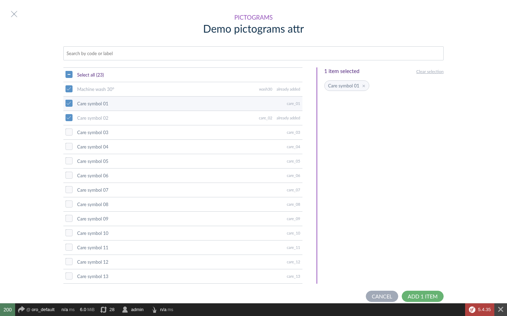

# Akeneo Reference Data Picker Bundle

A better way to fill **Reference data multi select** attributes in **Akeneo PIM 7 Community Edition**:
instead of searching and clicking values one at a time, pick them in a modal.



1. Click **+** next to the attribute on the product form.
2. Search by code or label and tick the results you want. **Select all (N)** ticks every loaded result.
3. Ticked items stay selected when you search again; they are listed on the right side, where you can
   remove them or clear the selection.
4. Click **Add N items**: they are appended to the attribute. Values already on the product are shown
   as "already added".

Values are still displayed as chips in the field, and removed with their ×. The picker replaces the
field of every reference data multi select attribute, on the product and product model edit forms and
in bulk "Add attribute values". Nothing changes in the data: the attribute type, its storage, imports,
exports and the API are Akeneo's.

It works with any reference data. With
[danmyers/akeneo-custom-entity-bundle](https://github.com/danmyers/akeneo-custom-entity-bundle) (custom
entities managed from the PIM), the search also matches every word of the query in any order.

## Requirements

- Akeneo PIM Community Edition 7.0
- PHP 8.1+

## Installation

1. Require the package:

    ```bash
    composer require danmyers/akeneo-reference-data-picker-bundle
    ```

2. Register the bundle in `config/bundles.php`, **after** Akeneo's bundles:

    ```php
    DanMyers\ReferenceDataPickerBundle\DanMyersReferenceDataPickerBundle::class => ['all' => true],
    ```

3. Rebuild the frontend:

    ```bash
    bin/console pim:installer:assets --symlink --clean
    yarn run update-extensions && yarn run less && yarn run webpack
    ```

The bundle only contains frontend resources: no database changes, no configuration.

## Behaviour details

| Situation | Behaviour |
|---|---|
| "Select all" | Ticks the results loaded so far; results loaded later with "Load more" arrive unticked. Shows a dash when only some are ticked; clicking it when all are ticked unticks them. |
| New search | Ticked items stay selected; "Select all" reflects the new results. |
| Values already on the product | Shown ticked and greyed out, ignored by "Select all". |
| Read-only attribute | No **+** button. |
| Results | 25 per page, labels in the catalog locale, from Akeneo's reference data search (`pim_ui_ajaxentity_list`). |

## Turning it off for your project

Map the field back to Akeneo's module in one of your bundles' `Resources/config/form_extensions/*.yml`
(registered after this bundle), or uninstall the bundle:

```yaml
attribute_fields:
    akeneo-multi-select-reference-data-field: pim/reference-multi-select-field
```

## Using the modal from your own code

```js
const Picker = require('danmyers-reference-data-picker/picker');

Picker.open({
  choiceUrl: url,            // a pim_ui_ajaxentity_list URL for the reference data
  title: 'Colors',
  subtitle: 'Add values',
  existingCodes: ['red'],    // shown as "already added"
}).then(selected => {
  // [{code: 'blue', label: 'Blue'}, ...] in the order they were ticked; rejected on cancel
});
```

## License

[MIT](LICENSE) © Daniel Myers
